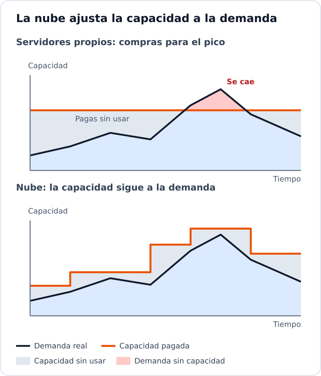

## Objetivo

Entender qué es la computación en la nube, en qué se diferencia de tener servidores propios y por qué las empresas la usan.

## Lo esencial

- La nube es **alquilar recursos de cómputo por internet y pagar solo por lo que usas**, en vez de comprar y mantener servidores.
- Sus cinco características (definición del NIST): autoservicio bajo demanda, acceso por red, recursos compartidos, elasticidad rápida y servicio medido.
- Cambia **gasto de capital** (comprar equipos) por **gasto operativo** (pagar mes a mes).
- No es "gratis ni siempre más barata": es más flexible. Mal usada, puede salir más cara.

## Explicación

### Antes de la nube

Una empresa que quería lanzar una app tenía que comprar servidores, esperar semanas a que llegaran, instalarlos en un cuarto con aire acondicionado y energía de respaldo, y calcular con meses de anticipación cuánta capacidad iba a necesitar. Si se quedaba corta, la app se caía; si compraba de más, el dinero quedaba quieto en equipos sin usar.

### Con la nube

Un proveedor (AWS, Azure, Google Cloud) ya tiene centros de datos enormes. Tú pides lo que necesitas desde una consola web, una línea de comandos o código, y en minutos lo tienes. Cuando no lo necesitas, lo apagas y dejas de pagar.



*Con capacidad fija pagas por el pico todo el tiempo y aun así puedes quedarte corto. En la nube la capacidad sigue a la demanda.*

### Las cinco características

| Característica | Qué significa | Ejemplo |
| --- | --- | --- |
| Autoservicio bajo demanda | Creas recursos tú mismo, sin llamar a nadie | Lanzar un servidor en 2 minutos desde la consola |
| Acceso amplio por red | Se usa desde internet, con cualquier dispositivo | Administrar tu cuenta desde el móvil |
| Recursos compartidos | Muchos clientes usan la misma infraestructura física, aislados entre sí | Tu servidor virtual corre en una máquina física junto a otros |
| Elasticidad rápida | Crecer o reducir capacidad en minutos, incluso automáticamente | Pasar de 2 a 20 servidores en una temporada de ventas |
| Servicio medido | Se cobra por uso exacto: horas, GB, solicitudes | Pagar por los segundos que corrió una función |

### Beneficios reales

1. **Velocidad:** probar una idea en horas, no en meses.
2. **Escala global:** desplegar en otro continente sin viajar.
3. **Elasticidad:** pagar por la capacidad que usas ahora, no por la que podrías necesitar.
4. **Servicios administrados:** bases de datos, colas, IA y más, sin instalar ni parchear nada.
5. **Resiliencia:** repartir tu app en varios centros de datos para sobrevivir fallas.

### Lo que no resuelve sola

- Si dejas recursos encendidos que no usas, pagas igual.
- La seguridad de tu configuración sigue siendo tu responsabilidad (lo verás en el tema de responsabilidad compartida).
- Para cargas muy estables y grandes, a veces un servidor propio o alquilado es más barato.

## Ejemplo práctico

Cuando ya tengas la AWS CLI configurada (lo harás en la fase 2), este comando te dice con qué identidad estás conectado. Es el "hola mundo" de la nube:

```bash
aws sts get-caller-identity
```

Salida esperada (con tus propios números):

```json
{
    "UserId": "AIDAEXAMPLE123456789",
    "Account": "123456789012",
    "Arn": "arn:aws:iam::123456789012:user/diego"
}
```

- `Account` es el número de tu cuenta de AWS.
- `Arn` es el identificador único de tu usuario dentro de AWS. Verás ARNs en todas partes.

## Errores comunes

1. **Pensar que la nube es "el servidor de otro" y ya.** Es eso, pero también cientos de servicios administrados que cambian cómo se diseña una app.
2. **Creer que siempre es más barata.** Es más barata cuando aprovechas la elasticidad y apagas lo que no usas.
3. **Probar sin alertas de costo.** Es el error número uno de quien empieza. Lo arreglas en el tema 8 de esta fase.

## Práctica (15 minutos)

1. Piensa en un negocio de tu región (una tienda, una clínica, una empresa de telecomunicaciones) y escribe qué parte de su operación podría ir a la nube y por qué.
2. Para ese negocio, escribe un ejemplo de cada una de las cinco características.
3. Escribe un caso donde la nube **no** sería la mejor opción y explica por qué.

## Repaso

1. ¿Cuáles son las cinco características de la nube según el NIST?
2. ¿Qué diferencia hay entre gasto de capital y gasto operativo?
3. ¿Por qué la elasticidad puede ahorrar dinero?
4. Menciona una situación en la que la nube podría salir más cara.

## Respuestas

1. Autoservicio bajo demanda, acceso amplio por red, recursos compartidos, elasticidad rápida y servicio medido.
2. El gasto de capital es comprar equipos por adelantado; el operativo es pagar por uso, mes a mes.
3. Porque solo pagas la capacidad que usas en cada momento, en lugar de comprar para el pico máximo.
4. Recursos olvidados encendidos, cargas grandes y muy estables durante años, o mucha transferencia de datos hacia internet.

## Para profundizar

- [Definición de computación en la nube del NIST (SP 800-145)](https://csrc.nist.gov/pubs/sp/800/145/final)
- [AWS: ¿Qué es la computación en la nube?](https://aws.amazon.com/what-is-cloud-computing/)
