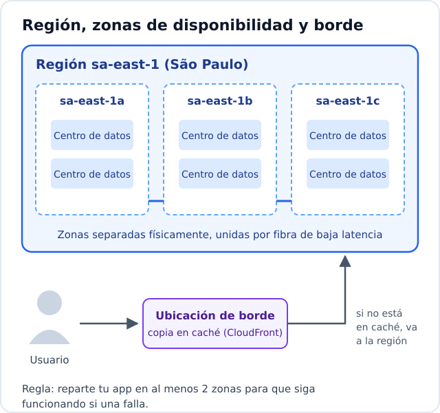

## Objetivo

Entender qué son las regiones, las zonas de disponibilidad y las ubicaciones de borde, y cómo elegir dónde desplegar.

## Lo esencial

- Una **región** es un área geográfica con varios centros de datos (por ejemplo, São Paulo o Virginia del Norte).
- Cada región tiene **al menos tres zonas de disponibilidad (AZ)**: grupos de centros de datos separados físicamente, con energía, refrigeración y seguridad propias.
- Las **ubicaciones de borde** acercan contenido a los usuarios (CloudFront, la CDN de AWS).
- Las **Local Zones** ponen algunos servicios dentro de una ciudad para bajar la latencia.
- Elegir región depende de: latencia, servicios disponibles, precio y leyes sobre dónde guardar datos.

## Explicación



*Una región tiene al menos tres zonas separadas. El borde acerca el contenido al usuario.*

### Regiones

AWS tiene decenas de regiones en el mundo; con la región de Chile, que abrió a clientes seleccionados en noviembre de 2026, son 39. Cada una es independiente: lo que creas en una región no aparece en otra a menos que lo copies.

En Latinoamérica hay tres:

| Región | Código | Nota |
| --- | --- | --- |
| América del Sur (São Paulo) | sa-east-1 | La más antigua de la zona; precios más altos que en EE. UU. |
| México (Central) | mx-central-1 | Abrió en 2025 |
| América del Sur (Chile) | (ver consola) | Disponibilidad general prevista para finales de 2026 |

Muchas empresas de Colombia usan **US East (Virginia del Norte), us-east-1**: suele ser la más barata y la primera en recibir servicios nuevos, aunque tiene más latencia que São Paulo para algunos casos.

### Zonas de disponibilidad

Una región se divide en AZ, nombradas como `sa-east-1a`, `sa-east-1b`, `sa-east-1c`. Están separadas por una distancia significativa para que un incendio o una falla eléctrica no afecte a todas, pero conectadas con fibra de baja latencia.

**Regla de oro:** si tu app debe estar siempre disponible, repártela en al menos dos AZ. Si una falla, la otra sigue atendiendo.

### Ubicaciones de borde y Local Zones

- **Ubicaciones de borde:** cientos de puntos en el mundo donde CloudFront guarda copias de tu contenido (imágenes, videos, páginas) cerca del usuario.
- **Local Zones:** extensiones de una región dentro de una ciudad grande, para apps que necesitan pocos milisegundos de latencia. AWS anunció Local Zones en varias ciudades de Latinoamérica, incluida Bogotá.

### Cómo elegir una región

1. **Latencia:** ¿dónde están tus usuarios? Más cerca, más rápido.
2. **Servicios:** no todos los servicios existen en todas las regiones; revisa antes.
3. **Precio:** el mismo servicio cuesta distinto según la región.
4. **Ley y clientes:** algunos contratos o regulaciones exigen guardar datos en ciertos países. En Colombia, la Ley 1581 tiene reglas sobre enviar datos personales al exterior.

## Ejemplo práctico

Listar las zonas de disponibilidad de São Paulo:

```bash
aws ec2 describe-availability-zones --region sa-east-1 \
  --query "AvailabilityZones[].ZoneName" --output text
```

Salida esperada:

```text
sa-east-1a    sa-east-1b    sa-east-1c
```

Listar las regiones habilitadas en tu cuenta:

```bash
aws ec2 describe-regions --query "Regions[].RegionName" --output text
```

Salida de ejemplo (más corta aquí; verás todas las habilitadas):

```text
us-east-1    us-east-2    us-west-2    sa-east-1    mx-central-1    eu-west-1 ...
```

## Errores comunes

1. **"No encuentro mi servidor".** Casi siempre estás mirando otra región en la consola. Revisa el selector de región arriba a la derecha.
2. **Poner todo en una sola AZ.** Si esa AZ tiene un problema, tu app se cae completa.
3. **Elegir región solo por precio.** Revisa también latencia, servicios y requisitos legales.

## Práctica (15 minutos)

1. Mide la latencia desde tu ubicación a varias regiones con una herramienta web de latencia de AWS (busca "AWS latency test") y anota los resultados de us-east-1, sa-east-1 y mx-central-1.
2. Si tuvieras que alojar una app para usuarios en Colombia, ¿qué región elegirías y por qué? Escribe dos ventajas y una desventaja.

## Repaso

1. ¿Cuántas zonas de disponibilidad tiene como mínimo una región de AWS?
2. ¿Qué diferencia hay entre una región y una zona de disponibilidad?
3. ¿Para qué sirven las ubicaciones de borde?
4. Menciona cuatro criterios para elegir una región.

## Respuestas

1. Tres.
2. La región es un área geográfica; la AZ es un grupo de centros de datos aislado dentro de esa región.
3. Para entregar contenido más cerca del usuario con CloudFront y reducir la latencia.
4. Latencia, servicios disponibles, precio y requisitos legales o de clientes.

## Para profundizar

- [AWS: infraestructura global](https://aws.amazon.com/about-aws/global-infrastructure/)
- [AWS: servicios disponibles por región](https://aws.amazon.com/about-aws/global-infrastructure/regional-product-services/)
- [Anuncio de la región de AWS en Chile](https://www.aboutamazon.com/news/aws/aws-south-america-chile-region-launch)
