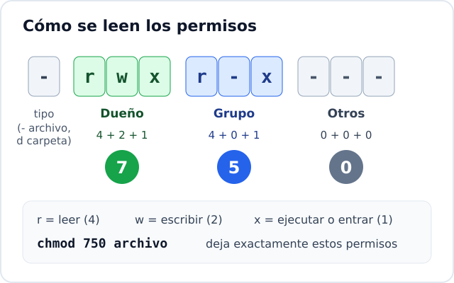

## Objetivo

Moverte por el sistema de archivos de Linux, leer y cambiar permisos, y entender usuarios y grupos, que es lo primero que necesitas al entrar a un servidor en la nube.

## Lo esencial

- En Linux **todo cuelga de `/`** (la raíz). No hay `C:` ni `D:`.
- Cada archivo tiene **dueño, grupo y permisos** para tres tipos de usuario: dueño, grupo y otros.
- Los permisos son **r** (leer), **w** (escribir) y **x** (ejecutar o entrar a una carpeta).
- `chmod` cambia permisos, `chown` cambia el dueño, `sudo` ejecuta como administrador.
- En la nube, un permiso mal puesto (por ejemplo, una llave SSH legible por todos) rompe la conexión o abre un hueco de seguridad.

## Explicación

### Carpetas que vas a usar

| Carpeta | Qué contiene |
| --- | --- |
| `/home/usuario` | Archivos de cada usuario (también `~`) |
| `/etc` | Configuración del sistema y de servicios (Nginx, SSH) |
| `/var/log` | Logs del sistema y de las aplicaciones |
| `/var/www` | Sitios web (por convención) |
| `/tmp` | Archivos temporales, se borran al reiniciar |
| `/usr/bin` | Programas instalados |
| `/root` | Carpeta del administrador (root) |

### Comandos básicos

| Comando | Qué hace |
| --- | --- |
| `pwd` | Muestra en qué carpeta estás |
| `ls -la` | Lista archivos, incluidos ocultos, con permisos |
| `cd /var/log` | Entra a una carpeta |
| `mkdir -p app/logs` | Crea carpetas (y las intermedias) |
| `cp`, `mv`, `rm` | Copiar, mover o renombrar, borrar |
| `cat`, `less`, `tail -f` | Ver un archivo; `tail -f` lo sigue en vivo |

### Cómo se leen los permisos



*Cada grupo de tres letras se convierte en un número sumando r=4, w=2 y x=1.*

| Número | Letras | Significado típico |
| --- | --- | --- |
| 7 | rwx | Todo |
| 6 | rw- | Leer y escribir |
| 5 | r-x | Leer y ejecutar |
| 4 | r-- | Solo leer |
| 0 | --- | Nada |

Combinaciones frecuentes:

- `644` para archivos normales: el dueño escribe, los demás solo leen.
- `755` para scripts y carpetas: todos pueden ejecutar o entrar, solo el dueño modifica.
- `600` para llaves privadas y archivos con secretos: solo el dueño.

### Usuarios, grupos y sudo

- **root** puede hacer todo. En servidores de nube normalmente entras con un usuario común (`ubuntu` o `ec2-user`) y usas `sudo` cuando necesitas permisos de administrador.
- Un **grupo** reúne usuarios para darles permisos juntos (por ejemplo, el grupo `www-data` para el servidor web).
- `sudo useradd -m -s /bin/bash ana` crea un usuario; `sudo usermod -aG sudo ana` lo agrega al grupo de administradores.

## Ejemplo práctico

Crear un script, revisar sus permisos y hacerlo ejecutable:

```bash
echo 'echo "Hola desde la nube"' > saludo.sh
ls -l saludo.sh
```

Salida esperada (cambia la fecha y el usuario):

```text
-rw-r--r-- 1 ubuntu ubuntu 25 Nov 26 10:30 saludo.sh
```

No tiene `x`, así que no se puede ejecutar todavía:

```bash
./saludo.sh
```

```text
bash: ./saludo.sh: Permission denied
```

Le damos permiso de ejecución y probamos:

```bash
chmod 755 saludo.sh
ls -l saludo.sh
./saludo.sh
```

```text
-rwxr-xr-x 1 ubuntu ubuntu 25 Nov 26 10:30 saludo.sh
Hola desde la nube
```

## Errores comunes

1. **`chmod 777` "para que funcione".** Da todos los permisos a todo el mundo. Encuentra qué permiso falta y da solo ese.
2. **Llave SSH con permisos abiertos.** SSH se niega a usar una llave privada que otros pueden leer; debe ser `600`.
3. **Trabajar todo el tiempo como root.** Un error tipográfico como root puede borrar el sistema. Usa `sudo` solo cuando haga falta.
4. **`rm -rf` con rutas en variables vacías.** Revisa dos veces antes de borrar de forma recursiva.

## Práctica (20 minutos)

Puedes hacerlo en WSL (Windows), en la terminal de macOS o en una máquina virtual con Ubuntu.

1. Crea la carpeta `~/practica/app` y dentro un archivo `config.txt`.
2. Cambia los permisos de `config.txt` a `600` y verifica con `ls -l`.
3. Crea un script que imprima la fecha (`date`), dale permiso de ejecución y córrelo.
4. Explica con tus palabras qué significa `-rw-r-----`.

## Repaso

1. ¿Qué significa el número de permisos `640`?
2. ¿Qué permisos debe tener una llave privada SSH?
3. ¿En qué carpeta buscarías los logs del sistema?
4. ¿Para qué sirve `sudo`?

## Respuestas

1. El dueño lee y escribe (6), el grupo solo lee (4) y los demás no tienen acceso (0).
2. `600`: solo el dueño puede leerla y escribirla.
3. En `/var/log`.
4. Para ejecutar un comando con permisos de administrador sin entrar como root.

## Para profundizar

- [Ubuntu: tutorial de la línea de comandos para principiantes](https://ubuntu.com/tutorials/command-line-for-beginners)
- [Linux Journey: permisos](https://linuxjourney.com/lesson/file-permissions)
