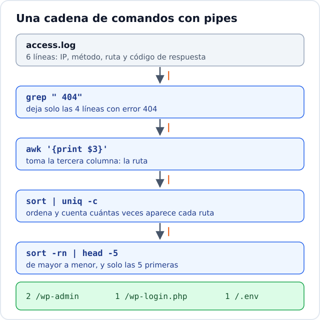

## Objetivo

Combinar comandos con pipes, buscar en logs y escribir scripts sencillos para automatizar tareas en un servidor.

## Lo esencial

- Un **pipe** (`|`) envía la salida de un comando a la entrada del siguiente.
- `grep` filtra líneas, `awk` toma columnas, `sed` reemplaza texto, `sort` y `uniq` ordenan y cuentan.
- `>` guarda la salida en un archivo (lo reemplaza); `>>` la agrega al final.
- Un **script** es un archivo con comandos; con `set -euo pipefail` se detiene ante errores.
- **cron** ejecuta scripts en horarios fijos.

## Explicación

### Pipes: armar una línea de procesamiento



*Cada comando hace una sola cosa y le pasa el resultado al siguiente.*

### Comandos de texto que más vas a usar

| Comando | Ejemplo | Qué hace |
| --- | --- | --- |
| `grep` | `grep -i error app.log` | Líneas que contienen "error" (sin distinguir mayúsculas) |
| `grep -v` | `grep -v DEBUG app.log` | Líneas que **no** contienen DEBUG |
| `awk` | `awk '{print $1}' access.log` | Primera columna (separada por espacios) |
| `sed` | `sed 's/viejo/nuevo/g' archivo` | Reemplaza texto |
| `sort` | `sort -n` | Ordena (numérico con `-n`, inverso con `-r`) |
| `uniq -c` | `sort \| uniq -c` | Cuenta líneas repetidas (necesita entrada ordenada) |
| `wc -l` | `wc -l archivo` | Cuenta líneas |
| `head`, `tail` | `head -5` | Primeras o últimas líneas |

### Redirecciones

| Símbolo | Qué hace |
| --- | --- |
| `>` | Escribe la salida en un archivo, reemplazando el contenido |
| `>>` | Agrega la salida al final del archivo |
| `2>` | Redirige los errores |
| `&>` | Redirige salida y errores juntos |

### Un script bien hecho

```bash
#!/usr/bin/env bash
set -euo pipefail          # para ante errores, variables vacías y fallos en pipes

ORIGEN="/var/www/html"
DESTINO="/home/ubuntu/respaldos"
FECHA=$(date +%Y-%m-%d)

mkdir -p "$DESTINO"
tar -czf "$DESTINO/web-$FECHA.tar.gz" "$ORIGEN"
echo "Respaldo creado: $DESTINO/web-$FECHA.tar.gz"

# borrar respaldos de más de 7 días
find "$DESTINO" -name "web-*.tar.gz" -mtime +7 -delete
```

Claves: comillas en las variables (`"$ORIGEN"`), `set -euo pipefail` y mensajes claros.

### cron: tareas programadas

`crontab -e` abre tu tabla de tareas. Cada línea tiene cinco campos de tiempo y el comando:

```text
# minuto hora día-del-mes mes día-de-la-semana  comando
0 2 * * *  /home/ubuntu/respaldo.sh >> /home/ubuntu/respaldo.log 2>&1
```

Esa línea corre el respaldo todos los días a las 2:00 a. m. (hora del servidor, que en la nube suele ser UTC: las 9:00 p. m. del día anterior en Colombia).

## Ejemplo práctico

Archivo `access.log` de ejemplo:

```text
181.53.10.24 GET /index.html 200
45.88.12.9 GET /wp-admin 404
181.53.10.24 GET /precios 200
45.88.12.9 GET /wp-admin 404
190.24.8.15 GET /.env 404
45.88.12.9 GET /wp-login.php 404
```

¿Qué rutas dan más errores 404?

```bash
grep " 404" access.log | awk '{print $3}' | sort | uniq -c | sort -rn | head -5
```

Salida esperada:

```text
      2 /wp-admin
      1 /wp-login.php
      1 /.env
```

¿Qué IP generó más solicitudes?

```bash
awk '{print $1}' access.log | sort | uniq -c | sort -rn | head -1
```

```text
      3 45.88.12.9
```

Las rutas `/wp-admin` y `/.env` son bots buscando vulnerabilidades: verás esto en cualquier servidor expuesto a internet.

## Errores comunes

1. **Variables sin comillas.** Si la ruta tiene espacios, `rm $CARPETA` puede borrar lo que no querías. Usa `"$CARPETA"`.
2. **`uniq` sin `sort` antes.** `uniq` solo agrupa líneas iguales consecutivas.
3. **Usar `>` cuando querías `>>`.** Borras el contenido anterior del archivo.
4. **Cron con rutas relativas.** Cron no corre desde tu carpeta; usa rutas absolutas en el script y en la línea de cron.

## Práctica (25 minutos)

1. Crea el `access.log` del ejemplo y reproduce los dos comandos.
2. Escribe un comando que cuente cuántas solicitudes tuvieron código 200.
3. Crea el script de respaldo, ejecútalo a mano y verifica el archivo creado.
4. Prográmalo con cron para que corra cada 5 minutos (`*/5 * * * *`), confirma en el log que funciona y luego quítalo.

## Repaso

1. ¿Qué hace el símbolo `|`?
2. ¿Por qué se pone `sort` antes de `uniq -c`?
3. ¿Qué diferencia hay entre `>` y `>>`?
4. ¿Qué significa la línea de cron `0 2 * * *`?

## Respuestas

1. Envía la salida de un comando como entrada al siguiente.
2. Porque `uniq` solo agrupa líneas repetidas que estén juntas.
3. `>` reemplaza el contenido del archivo; `>>` agrega al final.
4. Todos los días a las 2:00 (hora del servidor).

## Para profundizar

- [Bash Guide for Beginners (TLDP)](https://tldp.org/LDP/Bash-Beginners-Guide/html/)
- [crontab.guru: probar expresiones de cron](https://crontab.guru/)
- [ShellCheck: revisar errores en scripts](https://www.shellcheck.net/)
