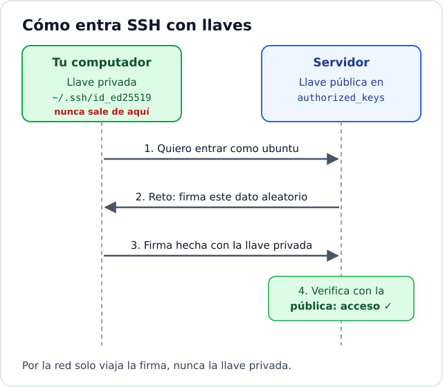

## Objetivo

Conectarte de forma segura a un servidor remoto con llaves SSH y entender por qué son más seguras que una contraseña.

## Lo esencial

- **SSH** es el protocolo para controlar un servidor remoto por la terminal, con todo el tráfico cifrado (puerto 22).
- Se usa un **par de llaves**: la **privada** se queda en tu computador y nunca se comparte; la **pública** se copia al servidor.
- El servidor guarda las llaves públicas permitidas en `~/.ssh/authorized_keys`.
- La llave privada debe tener permisos `600`.
- En AWS, además de SSH existe **Session Manager**, que conecta sin abrir el puerto 22 (lo verás en la fase 3).

## Explicación

### Cómo funciona la autenticación con llaves



*La llave privada nunca sale de tu computador: solo se envía una firma que demuestra que la tienes.*

### Por qué llaves y no contraseñas

| | Contraseña | Llave SSH |
| --- | --- | --- |
| Ataques de fuerza bruta | Posibles, los bots lo intentan todo el día | Prácticamente imposibles |
| Viaja por la red | Sí (cifrada) | No, solo una firma |
| Se puede robar mirando | Sí | No, es un archivo |
| Recomendada en la nube | No | Sí |

### Crear y usar llaves

```bash
ssh-keygen -t ed25519 -C "diego@portatil"
```

Crea dos archivos en `~/.ssh/`: `id_ed25519` (privada) y `id_ed25519.pub` (pública). Puedes poner una frase de contraseña para protegerla si alguien roba el archivo.

Copiar la pública a un servidor al que ya tienes acceso:

```bash
ssh-copy-id -i ~/.ssh/id_ed25519.pub ubuntu@203.0.113.10
```

En EC2, al crear la instancia eliges o creas un **par de llaves**: AWS pone la pública en el servidor y tú descargas la privada (`.pem`) una sola vez.

### El archivo ~/.ssh/config

Evita escribir comandos largos:

```text
Host web-aws
    HostName 203.0.113.10
    User ubuntu
    IdentityFile ~/.ssh/mi-llave-aws.pem
```

Ahora basta con `ssh web-aws`.

### Copiar archivos

```bash
scp informe.csv web-aws:/home/ubuntu/datos/
scp web-aws:/var/log/nginx/error.log .
```

### Endurecer SSH en el servidor

En `/etc/ssh/sshd_config`:

- `PasswordAuthentication no`: solo llaves.
- `PermitRootLogin no`: nadie entra directo como root.

Después: `sudo systemctl restart ssh`. Hazlo con una segunda sesión abierta, por si te quedas por fuera.

## Ejemplo práctico

Conectarte a una EC2 con la llave descargada:

```bash
chmod 600 ~/.ssh/mi-llave-aws.pem
ssh -i ~/.ssh/mi-llave-aws.pem ubuntu@203.0.113.10
```

La primera vez SSH te pide confirmar la identidad del servidor:

```text
The authenticity of host '203.0.113.10 (203.0.113.10)' can't be established.
ED25519 key fingerprint is SHA256:Xk3p...Q8w.
Are you sure you want to continue connecting (yes/no/[fingerprint])? yes
Welcome to Ubuntu 24.04.3 LTS (GNU/Linux 6.14.0-1011-aws x86_64)
ubuntu@ip-172-31-20-15:~$
```

Si olvidaste el `chmod 600`:

```text
WARNING: UNPROTECTED PRIVATE KEY FILE!
Permissions 0644 for '/home/diego/.ssh/mi-llave-aws.pem' are too open.
This private key will be ignored.
ubuntu@203.0.113.10: Permission denied (publickey).
```

## Errores comunes

1. **Compartir o subir a GitHub la llave privada.** Si pasa, bórrala del servidor y crea una nueva de inmediato.
2. **Permisos abiertos en la llave.** SSH la ignora; usa `chmod 600`.
3. **Usuario equivocado.** En Amazon Linux es `ec2-user`, en Ubuntu es `ubuntu`. Con el usuario incorrecto ves `Permission denied (publickey)`.
4. **Abrir el puerto 22 a todo internet.** Limítalo a tu IP en el Security Group, o usa Session Manager.

## Práctica (20 minutos)

1. Crea un par de llaves ed25519 en tu computador.
2. Si tienes una VM local (o WSL con un servidor SSH), copia la llave pública y conéctate sin contraseña.
3. Crea una entrada en `~/.ssh/config` con un alias.
4. Copia un archivo al servidor con `scp` y descárgalo de nuevo.

## Repaso

1. ¿Cuál de las dos llaves se copia al servidor?
2. ¿En qué archivo del servidor se guardan las llaves públicas permitidas?
3. ¿Por qué una llave SSH es más segura que una contraseña?
4. ¿Qué significa el error `Permission denied (publickey)`?

## Respuestas

1. La llave pública.
2. En `~/.ssh/authorized_keys` del usuario.
3. Porque la llave privada nunca viaja por la red y es prácticamente imposible de adivinar por fuerza bruta.
4. Que el servidor no aceptó tu llave: llave equivocada, usuario equivocado o permisos incorrectos en el archivo.

## Para profundizar

- [AWS: conectarse a una instancia Linux con SSH](https://docs.aws.amazon.com/AWSEC2/latest/UserGuide/connect-linux-inst-ssh.html)
- [GitHub Docs: generar una nueva llave SSH](https://docs.github.com/es/authentication/connecting-to-github-with-ssh/generating-a-new-ssh-key-and-adding-it-to-the-ssh-agent)
