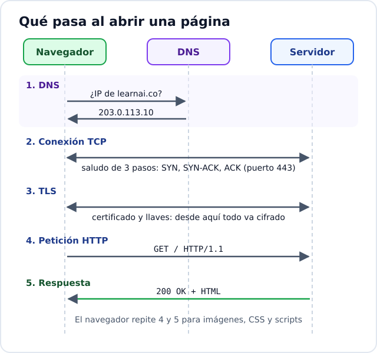

## Objetivo

Entender cómo viajan los datos por internet, qué son los puertos y qué pasa paso a paso cuando abres una página web.

## Lo esencial

- Internet funciona por **capas**: cada una resuelve un problema y se apoya en la de abajo.
- **IP** lleva los paquetes de una máquina a otra; **TCP** garantiza que lleguen completos y en orden; **UDP** es más rápido pero sin garantías.
- Un **puerto** identifica a qué programa va el tráfico dentro de una máquina (como el número de apartamento en una dirección).
- Una conexión se identifica por IP y puerto de origen, más IP y puerto de destino.
- En la nube, abrir o cerrar puertos es la base de los firewalls (Security Groups).

## Explicación

### Qué pasa cuando abres una página



*Todo esto ocurre en unos cientos de milisegundos cada vez que abres un sitio.*

### Las capas del modelo TCP/IP

| Capa | Qué resuelve | Ejemplos |
| --- | --- | --- |
| Aplicación | El "idioma" de cada servicio | HTTP, HTTPS, DNS, SSH, SMTP |
| Transporte | Entregar los datos al programa correcto, con o sin garantías | TCP, UDP |
| Internet | Llevar paquetes entre redes | IP (IPv4, IPv6), ICMP (ping) |
| Acceso a la red | Mover bits por el medio físico | Ethernet, Wi-Fi, fibra |

Cuando oigas hablar de **capa 4** (transporte) o **capa 7** (aplicación), viene del modelo OSI de 7 capas. En AWS verás: el Network Load Balancer trabaja en capa 4 y el Application Load Balancer en capa 7.

### TCP y UDP

| | TCP | UDP |
| --- | --- | --- |
| Conexión | Sí, con saludo de tres pasos (SYN, SYN-ACK, ACK) | No |
| Garantiza entrega y orden | Sí, reenvía lo que se pierde | No |
| Velocidad | Algo más lento | Más rápido |
| Usos | Web, SSH, bases de datos, correo | DNS, video en vivo, llamadas, juegos |

### Puertos que debes reconocer

| Puerto | Servicio |
| --- | --- |
| 22 | SSH |
| 53 | DNS |
| 80 | HTTP |
| 443 | HTTPS |
| 3306 | MySQL |
| 5432 | PostgreSQL |
| 6379 | Redis |
| 8000, 8080 | Apps en desarrollo (por convención) |

Los puertos del 0 al 1023 son "conocidos" y requieren permisos de administrador para escuchar en ellos. Cuando tu navegador se conecta, usa un puerto de origen alto y aleatorio (por ejemplo, 52114).

### Escuchar en 127.0.0.1 o en 0.0.0.0

- `127.0.0.1` (localhost): solo se puede conectar desde la misma máquina.
- `0.0.0.0`: acepta conexiones por cualquier interfaz de red, también desde fuera.

Un error clásico en la nube: la app corre bien, pero escucha en `127.0.0.1` y nadie desde fuera puede llegar.

## Ejemplo práctico

Ver qué puertos están escuchando en tu servidor:

```bash
sudo ss -tlnp
```

Salida de ejemplo:

```text
State   Recv-Q  Send-Q   Local Address:Port   Peer Address:Port  Process
LISTEN  0       511            0.0.0.0:80          0.0.0.0:*      users:(("nginx",pid=901,fd=6))
LISTEN  0       4096           0.0.0.0:22          0.0.0.0:*      users:(("sshd",pid=812,fd=3))
LISTEN  0       2048         127.0.0.1:8000        0.0.0.0:*      users:(("uvicorn",pid=1420,fd=7))
```

Lectura: Nginx (80) y SSH (22) aceptan conexiones de fuera; la API en el 8000 solo desde la misma máquina. Eso está bien si Nginx le reenvía el tráfico; está mal si querías que fuera accesible directamente.

Probar si un puerto de otra máquina responde:

```bash
nc -zv example.com 443
```

Salida de ejemplo (la IP que veas será la real del sitio):

```text
Connection to example.com (203.0.113.50) 443 port [tcp/https] succeeded!
```

## Errores comunes

1. **App escuchando en 127.0.0.1** cuando debía aceptar tráfico externo.
2. **Abrir puertos de bases de datos (5432, 3306) a internet.** Deben ser accesibles solo desde la red privada.
3. **Confundir el puerto del servidor con el del cliente.** El cliente usa un puerto alto aleatorio; en los firewalls importa el puerto de destino.
4. **Pensar que "ping no responde" significa "el servidor está caído".** Muchos firewalls bloquean ICMP, y el servidor puede estar bien.

## Práctica (20 minutos)

1. Ejecuta `sudo ss -tlnp` en tu máquina y explica cada línea.
2. Levanta un servidor de prueba con `python3 -m http.server 8000 --bind 127.0.0.1` y luego con `--bind 0.0.0.0`. Intenta abrirlo desde el móvil en la misma red Wi-Fi en ambos casos (usa la IP de tu computador).
3. Usa `nc -zv` para probar los puertos 22, 80 y 443 de algún dominio.
4. Dibuja los cinco pasos de abrir una página web sin mirar la imagen.

## Repaso

1. ¿Qué diferencia hay entre TCP y UDP?
2. ¿Qué puertos usan SSH, HTTPS y PostgreSQL?
3. ¿Qué significa que una app escuche en `127.0.0.1`?
4. ¿En qué capa trabaja un balanceador de aplicaciones (HTTP)?

## Respuestas

1. TCP establece conexión y garantiza entrega y orden; UDP no, pero es más rápido.
2. 22, 443 y 5432.
3. Que solo acepta conexiones desde la misma máquina.
4. En la capa 7 (aplicación).

## Para profundizar

- [Cloudflare: ¿qué es TCP/IP?](https://www.cloudflare.com/es-es/learning/ddos/glossary/tcp-ip/)
- [Cloudflare: el modelo OSI](https://www.cloudflare.com/es-es/learning/ddos/glossary/open-systems-interconnection-model-osi/)
