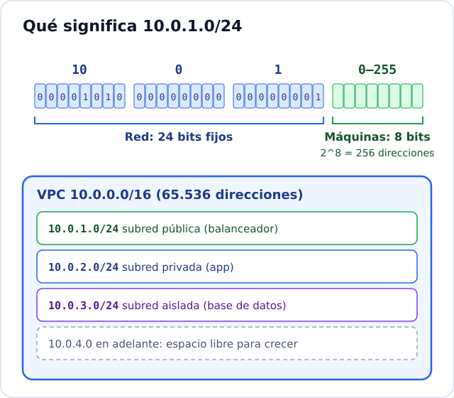

## Objetivo

Leer y diseñar rangos de direcciones IP con notación CIDR, que es exactamente lo que harás al crear una VPC en AWS.

## Lo esencial

- Una **IPv4** tiene 32 bits, escritos como cuatro números de 0 a 255 (por ejemplo, `10.0.1.25`).
- La notación **CIDR** `/n` dice cuántos bits fijos tiene la red: el resto son para las máquinas.
- Cantidad de direcciones = **2^(32 − n)**. Un `/24` tiene 256; un `/16` tiene 65.536.
- Las redes privadas usan rangos reservados: **10.0.0.0/8, 172.16.0.0/12 y 192.168.0.0/16**.
- En AWS, cada subred reserva **5 direcciones**, así que un `/24` deja 251 utilizables.

## Explicación

### La idea: parte fija y parte libre



*Más bits de red significa una red más pequeña.*

### Tabla de referencia

| CIDR | Direcciones | Utilizables en AWS | Uso típico |
| --- | --- | --- | --- |
| /16 | 65.536 | — | Una VPC completa |
| /20 | 4.096 | 4.091 | Subred grande (Kubernetes) |
| /24 | 256 | 251 | Subred común |
| /26 | 64 | 59 | Subred pequeña |
| /28 | 16 | 11 | La subred más pequeña que permite AWS |
| /32 | 1 | — | Una sola IP (por ejemplo, tu IP en un firewall) |

Truco: cada número menos en el `/n` **duplica** el tamaño. Un /23 es el doble de un /24.

### Redes privadas y públicas

- **Privadas** (no se enrutan en internet): `10.0.0.0/8`, `172.16.0.0/12`, `192.168.0.0/16`. Tu Wi-Fi de casa casi seguro usa `192.168.x.x`.
- **Públicas:** todas las demás, asignadas a empresas y proveedores. Tu servidor en la nube puede tener una IP pública además de la privada.

### Las 5 direcciones que reserva AWS

En la subred `10.0.1.0/24`, AWS reserva:

| Dirección | Uso |
| --- | --- |
| 10.0.1.0 | Dirección de red |
| 10.0.1.1 | Router de la VPC |
| 10.0.1.2 | Servidor DNS de AWS |
| 10.0.1.3 | Reservada para uso futuro |
| 10.0.1.255 | Dirección de broadcast |

### Cómo planear una VPC

1. Elige un rango privado que **no choque** con otras redes que conectarás (tu oficina, otras VPC). Muchas empresas usan `10.0.0.0/16` y luego tienen problemas al conectar; usar algo como `10.20.0.0/16` evita choques.
2. Divide en subredes por función y por zona de disponibilidad:
   - `10.20.1.0/24` pública en zona a, `10.20.2.0/24` pública en zona b.
   - `10.20.11.0/24` privada en zona a, `10.20.12.0/24` privada en zona b.
3. Deja espacio libre para crecer.

## Ejemplo práctico

Python trae el módulo `ipaddress` para comprobar cálculos:

```bash
python3 - <<'EOF'
import ipaddress
red = ipaddress.ip_network("10.20.0.0/16")
print("Direcciones en la VPC:", red.num_addresses)
subredes = list(red.subnets(new_prefix=24))[:3]
for s in subredes:
    print(s, "->", s.num_addresses - 5, "utilizables en AWS")
print("¿10.20.2.40 está en 10.20.2.0/24?", ipaddress.ip_address("10.20.2.40") in ipaddress.ip_network("10.20.2.0/24"))
EOF
```

Salida esperada:

```text
Direcciones en la VPC: 65536
10.20.0.0/24 -> 251 utilizables en AWS
10.20.1.0/24 -> 251 utilizables en AWS
10.20.2.0/24 -> 251 utilizables en AWS
¿10.20.2.40 está en 10.20.2.0/24? True
```

## Errores comunes

1. **Usar el mismo rango en todas las VPC.** Después no se pueden conectar entre sí ni con la oficina.
2. **Subredes demasiado pequeñas.** Kubernetes y los balanceadores consumen muchas IPs; un /28 se llena rápido.
3. **Olvidar las 5 reservadas.** Un /28 no tiene 16 IPs útiles en AWS, sino 11.
4. **Poner `0.0.0.0/0` en un firewall sin pensarlo.** Significa "todo internet".

## Práctica (25 minutos)

1. ¿Cuántas direcciones tienen un /22 y un /27? Calcúlalo con 2^(32 − n) y compruébalo con Python.
2. Divide `10.30.0.0/16` en: 2 subredes públicas /24, 2 privadas /22 y 2 aisladas /24 (para bases de datos). Escribe los rangos sin que se solapen.
3. Averigua tu IP privada (`ip addr` o `ipconfig`) y la pública (`curl ifconfig.me`) y explica la diferencia.
4. Usa un calculador de subredes en línea para verificar tu diseño del punto 2.

## Repaso

1. ¿Cuántas direcciones tiene un /24?
2. ¿Cuáles son los tres rangos de IP privados?
3. ¿Cuántas direcciones utilizables deja AWS en un /28?
4. ¿Qué significa `0.0.0.0/0`?

## Respuestas

1. 256.
2. 10.0.0.0/8, 172.16.0.0/12 y 192.168.0.0/16.
3. 11 (16 menos las 5 reservadas).
4. Todas las direcciones IPv4, es decir, cualquier origen o destino en internet.

## Para profundizar

- [AWS: dimensionamiento de VPC y subredes](https://docs.aws.amazon.com/vpc/latest/userguide/vpc-cidr-blocks.html)
- [AWS: direcciones IP reservadas en una subred](https://docs.aws.amazon.com/vpc/latest/userguide/subnet-sizing.html)
- [Calculadora de subredes](https://www.subnet-calculator.com/cidr.php)
